# MONET — User manual

*Dr. T. Francese*

MONET reads a molecular-dynamics trajectory, analyses it with ASE, MDAnalysis and its own methods, and extracts the configurations you need for quantum-chemistry calculations. It runs in your browser, on your own computer. This manual follows the order in which you work: **open the trajectory → check it and set the cell and the time axis → find out whether it is equilibrated and how correlated it is → analyse it → extract statistically independent configurations and write the QM inputs → keep the record of what you did**. Every step has a picture taken from the program itself.

> **Tip:** the manual is available at any time from the **Manual** button in the title bar. It opens in a new tab, so you can keep it beside the program. It is written in English and Italian (**EN / IT** at the top right of the manual); the program itself is in English, and the pictures are the same in both languages.

> **Note:** all the pictures use two small synthetic trajectories, so that you can repeat every step: an **ethanol molecule** (9 atoms, 1500 frames, with a start-up transient and a hydroxyl that rotates slowly) and a **box of 64 waters** (192 atoms, 400 frames, periodic). Write them with `python tools/manual_data.py DIRECTORY` in the MONET folder. The numbers in the pictures illustrate the program; they are not results about real ethanol or water.

## 1. Before you start

### 1.1 Starting MONET

MONET is a web page plus a small Python service (the *launcher*) that runs ASE and MDAnalysis on your computer. You start the launcher; it opens the page in your browser.

1. Install **Python 3.10 or newer** once ([python.org/downloads](https://www.python.org/downloads/); on Windows tick *Add python.exe to PATH*), or use conda.
2. Download MONET (**Code › Download ZIP** on GitHub, then extract the whole folder, or `git clone`).
3. Start the launcher:
  - **macOS**: double-click `start_monet.command` (the first time: right-click › **Open** › **Open**).
  - **Windows**: double-click `start_monet.bat` (if SmartScreen appears: **More info › Run anyway**).
  - **Linux**: run `./start_monet.command` in a terminal.
4. The first start creates a private environment (the `.venv` folder) and installs ASE, MDAnalysis, spglib and networkx. It needs internet once and takes a few minutes; later starts are immediate.
5. Your browser shows MONET at `http://127.0.0.1:8765`. The badge at the top right shows the ASE and MDAnalysis versions when everything is ready.
6. **Keep the terminal window open** while you work. When you have finished, press `Ctrl+C` in it to stop MONET.

With conda: `conda env create -f environment.yml`, `conda activate monet`, `python start_monet.py`. If the port is busy, add `--port 8766`; `MONET_PYTHON` chooses a particular Python.

Everything runs on your computer. The launcher listens on `127.0.0.1` only, asks for a per-session token, and keeps uploaded files in a private folder that is deleted when you stop it; your trajectory never leaves your computer (the internet is used only to install the Python packages). A trajectory is uploaded **once** (up to 200 GB, `--max-upload-gb`); every scan, analysis and extraction then runs as a background job with a progress bar and a **Cancel** button.

> **Warning:** opening `index.html` directly (a double-click on the file) shows the page but **does not start Python**: there is no ASE, no MDAnalysis and no manual. Always start MONET with the launcher.

### 1.2 The main window

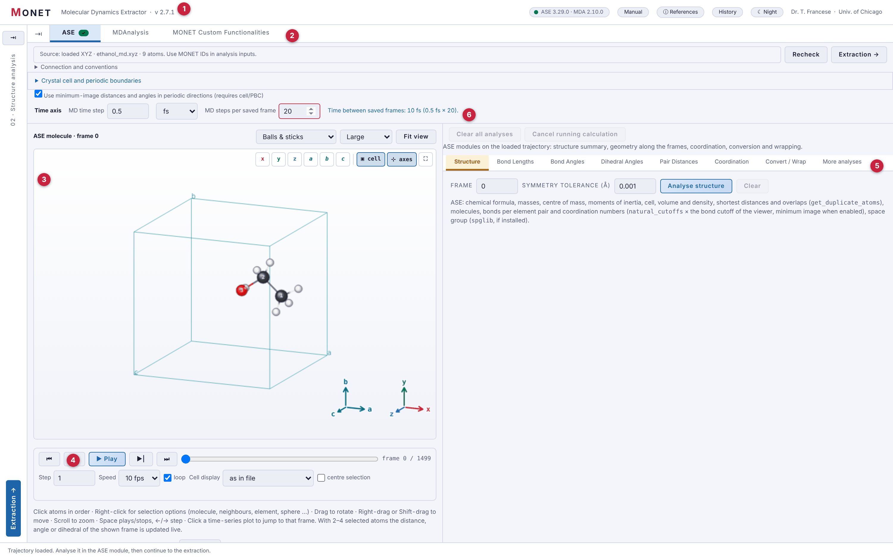

| Number | Area | What it is for |
|---|---|---|
| 1 | **Title bar** | The ASE / MDAnalysis status, **Manual**, **ⓘ References** (what to cite), **History** (record of every step), **☀ Day / ☾ Night**. |
| 2 | **Module tabs** | **ASE**, **MDAnalysis** and **MONET Custom Functionalities**: three families of analyses. They share the same trajectory, viewer, atom table, cell and time axis, so what you set in one is valid in the others. |
| 3 | **Molecular viewer** | The structure with the MONET atom numbers. Click atoms to pick them for an analysis; the buttons at the top right orient the view. |
| 4 | **Trajectory player** | Plays the trajectory; the plots follow it. |
| 5 | **Analysis tabs** | The analyses of the chosen module, one per tab. |
| 6 | **Time axis** | MD time step and number of MD steps between saved frames (section 2.2). |

On the far left the **workflow panel** holds the seven steps of the extraction: *01 File input · 02 Structure analysis · 03 Sampling · 04 Atom selection · 05 Options · 06 Processing · 07 Results*. While you analyse it folds into a narrow rail on the left edge; **⇥** opens it again, and the blue **Extraction →** button takes you to step 03 when the analysis is done (section 9).

### 1.3 How to read this manual

Section 2 explains the few ideas the whole program relies on; read it once, because the other sections refer to it. Sections 3 and 4 prepare the trajectory. Sections 5, 6 and 7 describe the analyses of the three modules, each with the same four parts:

* **What it tells you** — the quantity and why you would compute it;
* **Steps** — what to click and type, in order;
* **Reading the result** — what the plot and the numbers mean;
* **Watch out** — the usual mistakes.

Section 8 puts everything in the order of a real study; section 9 is the extraction; section 10 the record of what you did.

### 1.4 Day and night

: press ☀ Day / ☾ Night in the title bar to switch. Plots and pictures follow the theme.")

Press **☀ Day / ☾ Night** in the title bar. The choice is remembered by your browser; the manual has the same button.

## 2. Key concepts

### 2.1 Atoms are numbered once: the MONET ID

Every atom has one number, the **MONET ID**, used everywhere: in the viewer, in every analysis field, in the plot legends, in the extracted files and in the QM inputs. It is the position of the atom in the original file, counted from 1. ASE counts from 0 (ASE index = MONET ID − 1) and MDAnalysis receives the MONET ID as its `id`, so `id 5 7` in an MDAnalysis selection means MONET atoms 5 and 7 (`index` is the 0-based position). After an extraction the atoms keep the IDs of the original file: if you extract atoms 1 and 3, they are still called 1 and 3.

Where a field asks for **groups of atoms**, separate the groups with two spaces: `1 2  2 3` means the pairs 1–2 and 2–3. You rarely need to type them: pick the atoms in the viewer and press **Use selection** (section 4.2).

### 2.2 Frames, frame step and the time axis

A trajectory is a sequence of **frames** (saved configurations). Your MD code saved one frame every *n* MD steps of length Δt. MONET cannot know these two numbers, so you type them in the **Time axis** row:

* **MD time step** — Δt of the simulation (fs, atomic units or ps);
* **MD steps per saved frame** — *n*.

Their product is the time between two saved frames (0.5 fs × 20 = 10 fs in the pictures). Without the time axis, plots use frame numbers, and the analyses that need real time (autocorrelation, MSD, VDOS) stay disabled.

Most analyses also have a **Frame step**: 1 analyses every frame, 5 one frame in five. A larger step is faster, but the time between analysed frames grows accordingly (Δt × *n* × frame step).

### 2.3 Cell, periodic boundaries and the minimum image

In a periodic simulation the box (the **cell**) is repeated in space, and an atom that leaves through one face comes back through the opposite one. Two consequences:

* **Minimum image.** The true distance between two atoms is the shortest one among all the periodic copies. With a cell and the minimum-image box ticked (section 4.4), MONET uses it for bonds, distances, angles, dihedrals and molecules; without a cell it uses plain Cartesian distances.
* **Wrapped and unwrapped coordinates.** Codes often write *wrapped* coordinates (every atom put back into the box), so a molecule can look cut in two and an atom can jump by a box length between frames. *Unwrapping* removes the jumps, which is needed to measure how far atoms travel (MSD, RMSD of periodic runs). *Wrapping* does the opposite, for display or periodic QM inputs (section 5.7).

### 2.4 The active trajectory

All analyses and the extraction run on the **active trajectory**, named in the **Source** line at the top of the analysis area. At first it is the file you loaded. Some steps write a *derived* trajectory and can make it active:

* **Use the production window** keeps only the frames after equilibration (section 6.1);
* **Accept t\*** keeps one frame every *stride* frames, statistically independent (section 6.3);
* a PCA selection or an aligned trajectory from MDAnalysis (section 7).

, ↩ Full trajectory appears, and MD steps per saved frame has become 20 × 218 = 4360, so the time axis stays physical.")

When a derived trajectory becomes active, MONET multiplies *MD steps per saved frame* by the stride (the time axis stays correct), sets the sampling frequency of step 03 to 1, and keeps the frame numbers of the original run in every frame (`source_frame=`). **↩ Full trajectory** next to the Source line goes back to the full run. The history (section 10) records which trajectory every result came from.

### 2.5 Spread and error: why correlation matters

For every series MONET gives a mean and a **standard deviation (SD)**. The SD is the *spread* of the values (how much a bond vibrates); it is **not** the uncertainty of the mean. That uncertainty is the **standard error of the mean (SEM)**, and it depends on how many *independent* values you have.

Consecutive MD frames are almost copies of each other. The **autocorrelation time** τ says how long the system takes to forget its past; frames closer than that carry the same information. From the integrated time τ_int (in frames) MONET computes the **effective number of independent samples** N_eff = N / (2 τ_int) and the SEM = SD / √N_eff. A run of 1500 frames may have N_eff ≈ 10.

This is why MONET measures τ before extracting configurations: configurations taken every few frames would be repeats, and a QM average over them would look far more precise than it is. Angles and dihedrals use circular statistics (350° and 10° average to 0°, not 180°); R, from 0 to 1, says how concentrated the angles are.

### 2.6 The workflow at a glance

, decide which configurations are independent (middle), extract (right); the history records everything.")

## 3. Step 1 — Open the trajectory

### 3.1 Open a file

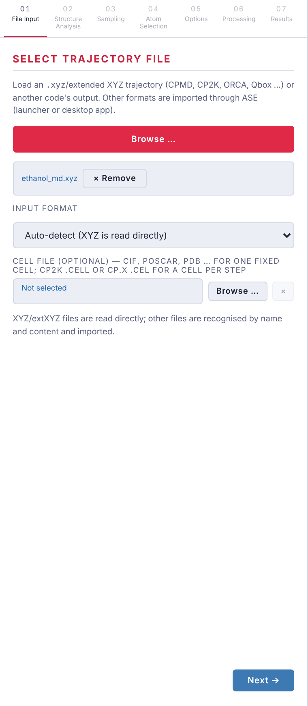

**Steps.**

1. Press **Browse …** in step 01 and choose an XYZ or extended XYZ trajectory (CPMD, CP2K, ORCA, Qbox …).
2. Leave **Input format** on *Auto-detect* (XYZ is read directly).
3. If the file has no cell but the simulation was periodic, add a **cell file** (section 3.2).
4. Press **Next →**. MONET indexes the file, shows the number of configurations and atoms, and opens the **ASE** tab with the first frame in the viewer.

**Watch out.** All frames must have the same atoms in the same order. Extended XYZ `species`/`pos` columns, `Lattice` and `pbc` are read; other per-atom columns are not carried into the extracted files. **× Remove** clears a file chosen by mistake.

### 3.2 Other formats

 shows the extra file it needs: the reference structure or topology.")

Other formats are imported (through ASE or MDAnalysis) into an extended XYZ, which then becomes the trajectory MONET works on. Some formats store coordinates without element names; for them MONET asks for a second file:

| Format | What to add |
|---|---|
| VASP XDATCAR, OUTCAR, `vasprun.xml`, POSCAR/CONTCAR; Quantum ESPRESSO `pw.x` output; ORCA output; Qbox output; LAMMPS dump; ASE `.traj`; CIF; Gaussian output | nothing (via ASE) |
| Quantum ESPRESSO `cp.x` `.pos` (+ `.cel`); CP2K DCD; CPMD `TRAJECTORY` | a **reference structure** with the same atom order (any file ASE or MDAnalysis can read, e.g. the first frame as XYZ); for `.cel` say whether rows or columns are the lattice vectors |
| GROMACS XTC, TRR; CHARMM/NAMD DCD; AMBER NetCDF | a **topology** (GRO, PDB, TPR, PSF, PRMTOP …) as reference structure. Without it every atom is element **X**: distances, angles, dihedrals, RMSD, MSD and unwrapping still work, element-based analyses do not (a warning says so). |
| GROMACS GRO, multi-model PDB, any other format MDAnalysis reads | nothing |

**Steps.**

1. Choose the format in **Input format** (or keep *Auto-detect*). The menu *All ASE-readable formats* lists every other format your ASE can read.
2. If a **Reference structure / topology** field appears, press its **Browse …** and choose the file.
3. For an XYZ trajectory of a periodic run, optionally add a **Cell file**: a CIF, POSCAR or PDB gives one fixed cell to every frame; a CP2K `.cell` or cp.x `.cel` gives one cell per step (NPT).
4. Press **Next →**. Importing needs the launcher.

### 3.3 Check that the atoms are the same everywhere

**What it tells you.** Whether MONET, ASE and MDAnalysis read the same atoms in the same order. If they did not, a MONET ID would point at different atoms in different modules (section 2.1).

 and 128 bonds.")

**Steps.**

1. Open the **MDAnalysis** module tab, then **Topology & consistency**. The check runs by itself after loading; **Check atom identity** repeats it.
2. Read the green box: number of atoms, frames, residues and bonds.
3. Scroll the table: for every atom, the MONET element, the ASE element and the MDAnalysis name, residue and mass.

**Reading the result.** A green box means the three programs agree. Red cells mark a mismatch (count, element or first-frame coordinates). For XYZ files every bonded molecule becomes a residue named after its formula, so selections such as `resname H2O` work.

**Watch out.** A mismatch almost always means a wrong reference structure or topology (different atom order): load the right one before analysing.

## 4. Step 2 — Look at the structure and set the cell and the time axis

### 4.1 The viewer

 look down an axis, ⊹ axes shows the orientation axes, ▣ cell shows the cell, ⛶ expands the viewer. Under it, the trajectory player.")

* **Drag** rotates, **right-drag** or **Shift-drag** moves, the **wheel** zooms; **Fit view** resets the orientation.
* The menus above the viewer choose the style (**Balls & sticks, Sticks, Space-filling, Lines, Points**) and the size (Compact, Large, Full height).
* **x y z** look down that Cartesian axis (click again to look from the other side); with a cell, **a b c** do the same along the cell vectors. **⊹ axes** shows or hides the orientation axes in the corner; **▣ cell** shows or hides the cell box (display only: the analyses still use the cell). **⛶** expands the viewer to the whole window; Esc brings it back.
* Large systems stay responsive: above 2,500 atoms the viewer draws lines while you rotate.

### 4.2 Picking atoms for an analysis

**What it is for.** Instead of typing MONET IDs, you click the atoms and MONET writes them into the analysis you choose.

; the player line shows their live dihedral. Bottom: the picks in order, the selection tools, and Use selection for → Dihedrals — groups of 4.")

**Steps.**

1. Click the atoms **in the order the analysis needs them**: 2 for a bond, 3 for an angle (the middle one is the vertex), 4 for a dihedral in bond order (C–C–O–H here). Picked atoms turn gold with their order number; a row of the atom table under the viewer does the same.
2. Check the chips under **Selected in order**; click a chip's **×** (or the atom again) to remove it, **Clear selection** to start again.
3. In **Use selection for** choose the analysis (RMSD, pair distances, bonds, angles, dihedrals, RMSD matrix, RDF, MSD, VDOS, autocorrelation, fluctuations).
4. Press **Use selection**. MONET opens that analysis with the IDs filled in; set its options and press its **Compute** button.

To add more groups to the same analysis, pick the next atoms, tick **Append to existing atom groups** and press **Use selection** again. If you pick bonded atoms in any order (a carbon and its three hydrogens, say), MONET writes every bond, angle or dihedral among them.

### 4.3 More ways to select

: select it, its molecule, its bonded neighbours, the atoms within R Å or every atom of its element; extend, invert or clear the selection; centre the view.")

* **Right-click** an atom (or empty space) for a menu: the atom, its molecule, its bonded neighbours, the atoms within R Å, all atoms of its element; extend, invert or clear the selection.
* **Selection tools** under the viewer do the same with buttons (*Select element, + Element, All, Invert, + Bonded, + Molecules, + Within R*).
* **Find bonded chains by element** finds every bond, angle or dihedral that matches a pattern such as `O H`, `H O H` or `C C O H` (`*` is any element) and writes them into the geometry, autocorrelation or fluctuation inputs (**Fill**), optionally only among the selected atoms.
* **Select with MDAnalysis syntax** (e.g. `resname H2O and element O`, `around 3.5 resname LIG`) picks the atoms of an MDAnalysis selection.

Molecules and neighbours come from the bonds of the first frame (covalent radii × the **bond cutoff**, 1.2 by default; change it for unusual bonds).

### 4.4 Cell and periodic boundaries

**What it is for.** The cell decides which distances are periodic (section 2.3). A cell that comes with the trajectory is used automatically; this panel shows it and lets you set another one.

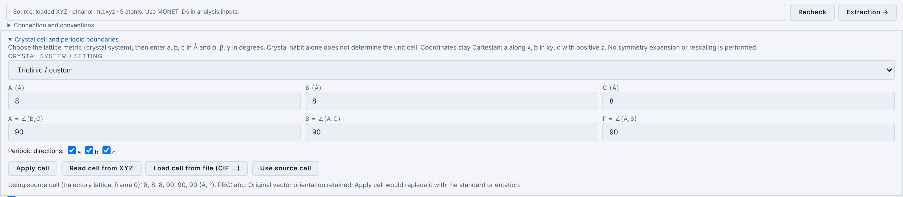

**Steps.**

1. Open **Crystal cell and periodic boundaries** at the top of the ASE module.
2. Read the status line: *Using source cell* means the file has a cell (extended XYZ `Lattice=`, or a cell file given at import) and MONET uses it. You can stop here.
3. If there is no cell, or it is wrong: choose the crystal system, type a, b, c in Å and α, β, γ in degrees, tick the periodic directions and press **Apply cell**. Alternatively press **Load cell from file (CIF …)** to read the six parameters from a CIF, POSCAR, PDB or CP2K `.cell`.
4. Keep **Use minimum-image distances** ticked for periodic systems.

**Watch out.** Applying a cell or changing the minimum-image box clears the previous analyses on purpose, so results computed with different geometries are never mixed. Typed cells follow the convention *a along x, b in the xy plane*; the coordinates are neither rotated nor rescaled, so use a cell written in that orientation. **Use source cell** removes your cell and goes back to the file's one.

### 4.5 The time axis

**Steps.**

1. In the **Time axis** row type the **MD time step** and choose its unit (fs, a.u. or ps).
2. Type the **MD steps per saved frame** (how often your code wrote the trajectory).
3. Check the blue line next to it: *Time between saved frames: 10 fs (0.5 fs × 20)*.

The same two fields appear at the top of the autocorrelation, fluctuation, MSD and VDOS panels; they are the same values, so changing one changes all. A missing time step is shown in red where it is needed.

### 4.6 The player

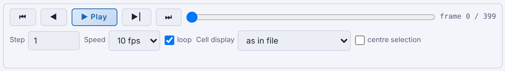

**Steps.**

1. Press **▶ Play** (or Space when the viewer has focus); ←/→ move one frame.
2. **Step** skips frames, **Speed** sets the frames per second, **loop** restarts at the end.
3. **Cell display** wraps whole molecules or atoms into the box for display only; **centre selection** keeps the picked atoms in the middle.

While playing, a dashed cursor shows the current frame on the RMSD, bond, angle, dihedral and MDAnalysis plots, and clicking those plots jumps to that frame. With 2, 3 or 4 picked atoms the line under the player shows their distance, angle or dihedral in the current frame.

## 5. The ASE module

The ASE module holds structure, geometry and the analyses of the ASE library. Every analysis tab has **Clear analysis**, **Download plot PNG** (2400 px wide, in the current theme) and **Download data CSV**. **Clear all analyses** empties every tab and keeps the trajectory and the settings.

### 5.1 Structure

**What it tells you.** A summary of one frame: formula, masses, centre of mass, moments of inertia, cell, volume and density, the shortest distances (and overlapping atoms), molecules, bonds per element pair, coordination numbers and the space group. It is the quickest check that the file, the cell and the bonds are what you expect.

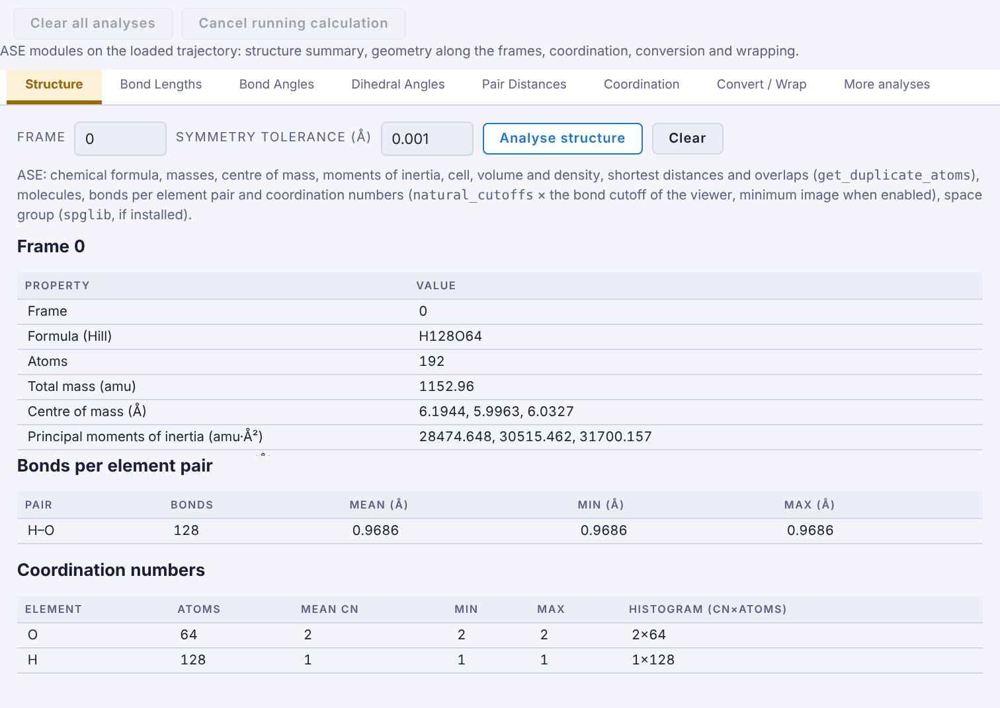

**Steps.**

1. Open **ASE › Structure**.
2. Type the **Frame** (0 is the first) and, if needed, the **Symmetry tolerance** for the space group.
3. Press **Analyse structure**.

**Reading the result.** Bonds per element pair and coordination numbers show whether the molecules are intact (here every O has two H and every H one O). An unexpected element pair or a very short distance points to wrong elements or a missing cell.

### 5.2 Bond lengths

**What it tells you.** How the distance between two bonded atoms changes along the trajectory, its mean, its spread and its distribution.

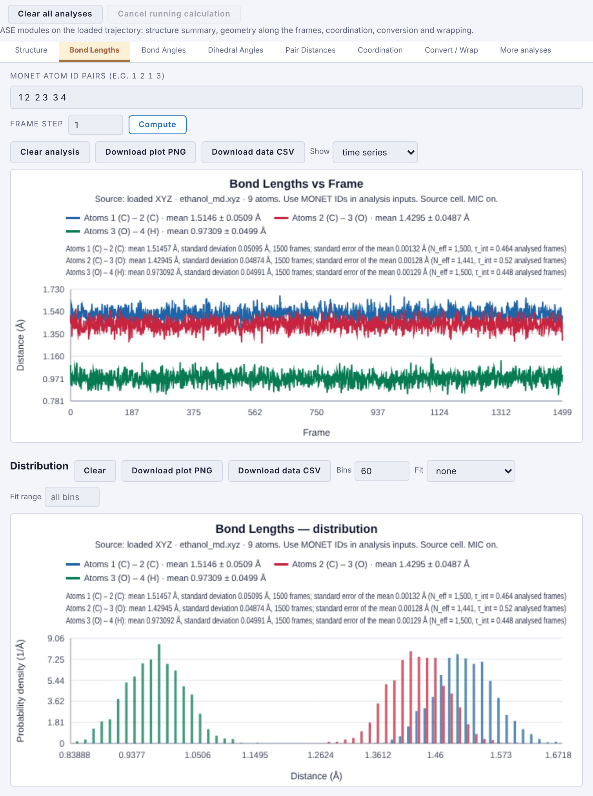

**Steps.**

1. Pick the two atoms in the viewer and use **Use selection for → Bond lengths** (section 4.2), or type the pairs in **ASE › Bond Lengths** (`1 2  2 3  3 4`).
2. Set the **Frame step** (1 = every frame).
3. Press **Compute**.

**Reading the result.** The top plot is the bond against the frame; the legend gives mean ± SD (the spread, section 2.5). The note above the plot adds the SEM, corrected for the correlation of the frames. The **Distribution** plot below is the histogram of the values; **Fit** adjusts a Gaussian, Lorentzian, pseudo-Voigt, von Mises or two Gaussians (all bins or a **Fit range**) and lists the parameters with their errors. *Show → dot histogram* draws one dot per frame.

**Watch out.** The fit errors treat the bins as independent and are usually smaller than the SEM; quote the SEM for the uncertainty of the mean.

### 5.3 Bond angles

**What it tells you.** The angle at a central atom (for example C–O–H) along the trajectory.

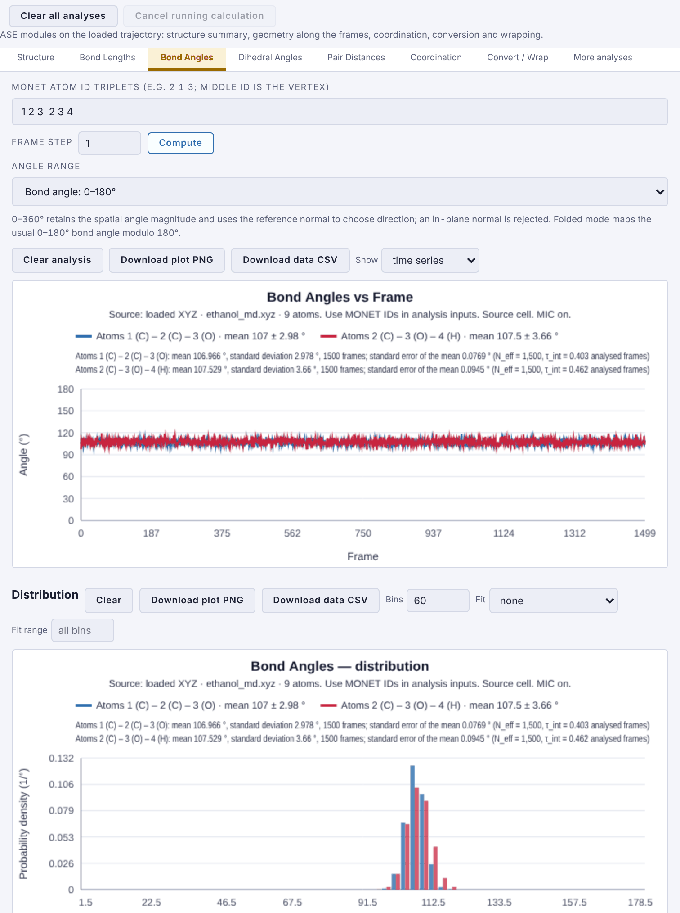

**Steps.**

1. Pick three atoms with the vertex in the middle and use **Use selection for → Bond angles**, or type triplets (`1 2 3  2 3 4`).
2. Choose the **Angle range**: the usual 0–180°; 0–360° with a reference normal when the side matters; or a folded range.
3. Press **Compute**.

**Watch out.** Changing the range clears the result; compute again.

### 5.4 Dihedral angles

**What it tells you.** The torsion of four atoms about the middle bond: conformational changes, rotations of groups, twists between units.

; the note adds the SEM corrected for the correlation of the frames (N_eff, τ_int).")

**Steps.**

1. Pick four atoms in bond order (here 1 C, 2 C, 3 O, 4 H) and use **Use selection for → Dihedrals**, or type `1 2 3 4`.
2. Choose the **Angle range**:
  - *0–360°* (ASE convention) when the two senses of rotation are different;
  - *−90…+90° folded* or *0…180° folded* when orientations 180° apart are equivalent (a symmetric group). Choose the folded range whose edge is far from your values, so the trace does not jump.
3. Press **Compute**.

**Reading the result.** Mean and SD are circular (section 2.5); the note gives R, N_eff and τ_int. **Show → polar plot** draws the circular histogram (stacked dots or frame index) with the mean of each series and optional **Reference** directions, e.g. an experimental angle.

### 5.5 Pair distances

**What it tells you.** A histogram (counts) of all the distances between the chosen atoms, from 0.5 Å to Rmax: a quick look at which distances occur.

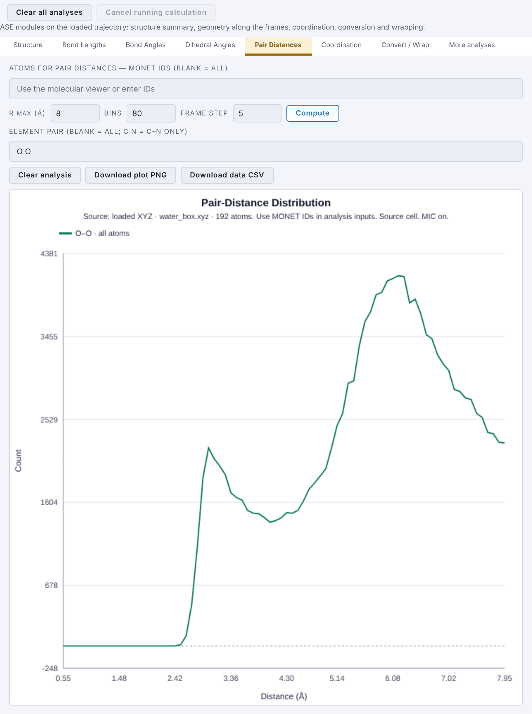

**Steps.**

1. Optionally enter atoms (blank = all) and an **element pair** (`O O`; `C N` for exactly C–N pairs).
2. Set **R max**, **Bins** and **Frame step**, then press **Compute**.

**Watch out.** These are raw counts, which grow with r just because there are more atoms far away. For a normalised g(r) use the **RDF** tab (section 6.7).

### 5.6 Coordination

**What it tells you.** How many neighbours each atom has in every frame: bond breaking and forming, changes of coordination.

 in every analysed frame: the mean per element and the first eight atoms.")

**Steps.**

1. Optionally enter the atoms (blank = all) and the **Frame step**.
2. Press **Compute coordination**.

**Reading the result.** Flat lines mean stable bonding; a step means a bond formed or broke. For a list of the events use *More analyses › Bonds formed and broken* (section 5.8).

### 5.7 Convert and wrap

**What it is for.** Writing the trajectory in another format, or with continuous (unwrapped) or wrapped coordinates (section 2.3).

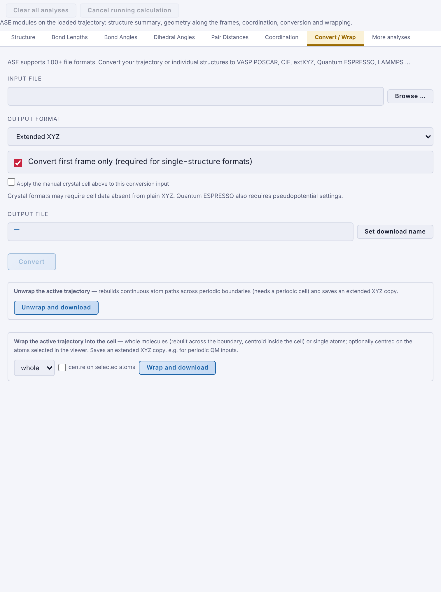

**Steps to convert a file.**

1. Press **Browse …** for the input file.
2. Choose the **Output format** (extended XYZ, XYZ, VASP, CIF, LAMMPS data, FHI-aims, Turbomole, Gaussian input, DFTB+ or JSON).
3. Keep *Convert first frame only* for formats that hold one structure; untick it for multi-frame extended XYZ or JSON. For a plain XYZ you can apply the cell of section 4.4.
4. Set the download name and press **Convert**, then download the file.

**Steps to unwrap or wrap the active trajectory.**

1. **Unwrap and download** writes continuous atom paths (needs a periodic cell).
2. For wrapping choose *whole* (molecules rebuilt across the boundary and moved into the cell) or *atoms* (every atom moved into the cell), optionally **centre on selected atoms**, and press **Wrap and download**: useful before periodic QM inputs.

**Watch out.** VASP needs a complete cell. Quantum ESPRESSO is not offered here because the pseudopotentials are not collected; use the QM inputs of step 05 instead (section 9.4).

### 5.8 More analyses

**What it is for.** The other analyses of the ASE library that apply to existing configurations: self-diffusion per element, energies, forces, temperature and pressure stored in the file, bonds, angles and dihedrals by element type, molecules and species, bonds formed and broken, RDF, space group, dimensionality, layers, powder XRD and SAXS, Bravais lattice and Niggli cell, supercell trajectory, cell volume and density.

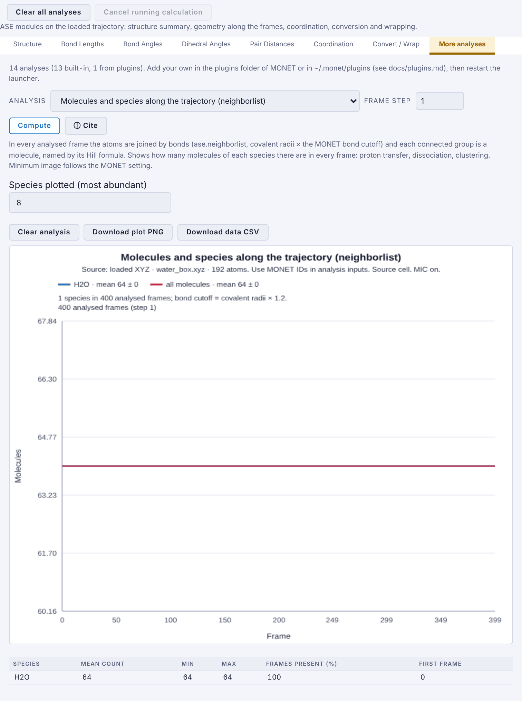

**Steps.**

1. Open **ASE › More analyses** and choose the analysis in the menu; its description and fields appear.
2. Fill the fields; **← picked** inserts the atoms picked in the viewer.
3. Set the **Frame step** and press **Compute**. **ⓘ Cite** shows what to cite for it.

Plugins of the ASE engine appear in the same menu (section 11).

## 6. MONET Custom Functionalities

MONET's own analyses. They are in the order of a study: first decide which part of the run is usable (6.1) and how correlated it is (6.2, 6.3), then analyse it (6.4–6.9). The first tab, **3D viewer & extraction**, belongs to the extraction (section 9).

### 6.1 Is the run equilibrated? Detect equilibration

**What it tells you.** The beginning of a simulation often still remembers the starting structure (a *transient*). Averages that include it are biased. MONET finds where the *production* part starts.

: N_eff against the start of production t₀; the largest value (gold) is where production starts. Here the start-up transient is discarded up to 2,750 fs.")

**Steps.**

1. Set the time axis (section 4.5).
2. Open **MONET Custom Functionalities › Autocorrelation**.
3. Choose a slow, meaningful **Quantity** and its **MONET IDs** (here the dihedral `1 2 3 4`).
4. Press **Detect equilibration**.
5. If a transient is found, press **✂ Use the production window from t₀**: the frames after t₀ become the active trajectory (section 2.4).

**Reading the result.** For every possible start t₀ in the first half of the run, MONET computes how many independent samples the rest would give, N_eff(t₀). Cutting the transient removes frames but also removes a slow drift, so N_eff first grows; the maximum (gold line) is where production starts (here 2,750 fs, N_eff from 10.1 to 16.9). If no transient is found, MONET says so and you keep the whole run.

**Watch out.** The answer depends on the quantity: use one that relaxes slowly. Then compute the autocorrelation again on the production window.

### 6.2 How correlated is it? Autocorrelation

**What it tells you.** The **autocorrelation function** C(t) measures how similar the quantity is to itself after a time t: 1 at t = 0, then decaying towards 0. The time it takes is the correlation time τ (section 2.5), and it decides how often you can sample independent configurations.

 of the dihedral (blue) and its fit (red dashed); t* (gold dashed) is where the fit reaches its plateau. Under the plot, block averaging of the standard error.")

**Steps.**

1. Set the time axis (section 4.5).
2. Choose the **Quantity** (dihedral, bond angle, bond length or RMSD) and type the **MONET IDs**, or send them with **Use selection for → Autocorrelation**. Several groups are averaged.
3. Keep the defaults the first time: *Normalised fluctuations*, fit *exp(−t/τ)*, fit up to the *first zero crossing*, τ_int with the *Sokal window*.
4. Press **Compute ACF**.

**Reading the result.**

* **τ (fit)**: from the fit of exp(−t/τ) to C(t) (here 727 ± 14 fs). **τ_int**: the integral of C(t), used for N_eff and the SEM (here 746 fs, with its error).
* **Run length in τ**: T / τ. Below 20 τ MONET warns, below 50 τ it notes that τ and the stride are approximate (here 20.6 τ: the run is short).
* **Block averaging** (plot below): the SEM computed from blocks of growing length. It should reach a plateau; if it still grows at the longest blocks (as here), the run is too short for a reliable error bar.

**Other options.** *Correlation → Circular* for angles; *Dihedral range → 0–180° folded* when opposite orientations are equivalent; *Fit model → (1 − c)·exp(−t/τ) + c* when C(t) levels off above zero; *Max lag* limits the longest lag (default half the run). Drag across the plot to zoom, double-click to reset.

### 6.3 From τ to independent configurations

**What it is for.** Turning τ into a sampling stride and writing the trajectory of independent configurations that the extraction will use.

 = 2,177 fs for ε = 5 %, rounded up to one configuration every 218 saved frames: 7 independent configurations out of 1500, with residual correlation g ≈ 1.27.")

**Steps.**

1. After **Compute ACF**, read the green box. The fitted curve reaches its plateau within a tolerance ε at **t\* = τ·ln(1/ε)** (3.0 τ for ε = 5 %, 4.6 τ for 1 %), drawn as the gold dashed line on the plot.
2. Check that t* falls where the measured curve has really decayed. If not, change **Plateau tolerance ε**, type τ in **Use τ**, or type another **Decorrelation time t\***.
3. Read the result: the stride (t* divided by the time between frames, rounded up; here 218 frames), the number of configurations it gives, and the residual correlation *g* of the sampled configurations (close to 1 means independent).
4. Choose what to do with it:
  - **Accept t\* and build the uncorrelated trajectory** writes an extended XYZ with one frame every *stride* frames. With *analyse it in MONET right away* ticked, it becomes the active trajectory (section 2.4), and the extraction will use exactly these configurations;
  - **Only set the sampling frequency** copies the stride to step 03 and keeps the full trajectory active.

**Watch out.** A short run gives few independent configurations (7 here). That is the honest number: taking more would repeat the same information.

### 6.4 Fluctuations and trends

**What it tells you.** For every bond, angle, dihedral or atom at once: how much it fluctuates, whether it drifts during the run, and at which frequency it oscillates. It finds the floppy parts of a molecule and checks that nothing is still changing.

. The table gives the mean, SD, minimum, maximum, 5–95 % range, trend with its error and R², drift between the two halves, block error and the dominant frequency.")

**Steps.**

1. Choose what to **Map** (bond lengths, angles, dihedrals or atoms).
2. In **Items** choose *all found among the atoms below* (every bond, angle or dihedral of the first-frame connectivity among the atoms entered, blank = all) or *only the groups entered below*.
3. Optionally set the time axis, to get trends per ps and frequencies in cm⁻¹.
4. Press **Compute**.
5. Click a row of the table to plot that item along the trajectory, with its mean, ±SD and trend line, and to highlight it on the molecule.

**Reading the result.** **Colour and bars by** chooses what the bars and the colours on the molecule show: SD, range, |trend|, |drift|, frequency or mean. A trend is marked *significant* only when the five block averages follow a line beyond three times the error of the slope and the change exceeds 10 % of the SD, so fast oscillations are not mistaken for drift. **Vibration arrows** and **displacement ellipsoids** (atoms; 50, 90 or 99 %) show how and where atoms move. *Download statistics CSV* saves the table.

### 6.5 RMSD (Kabsch)

**What it tells you.** The **root-mean-square deviation** of the atoms from a reference frame: how far the structure has moved away from it. With **Kabsch alignment** each frame is first rotated and translated onto the reference, so only changes of shape count.

: displacement from the first frame with Kabsch alignment on; the distribution is below.")

**Steps.**

1. Enter the atoms (blank = all) or send them with **Use selection for → RMSD**.
2. Tick **Kabsch alignment** to remove translation and rotation; tick **Unwrap PBC** for periodic runs (section 2.3).
3. Choose the **Reference frame** (the first by default) and press **Compute RMSD**.

**Reading the result.** A plateau means the structure fluctuates around one state; a step means it moved to another. Without alignment the RMSD also contains the motion of the whole molecule.

### 6.6 RMSD matrix

**What it tells you.** The RMSD between every pair of frames, as a coloured map: which frames are alike, and whether the system visits several states and comes back.

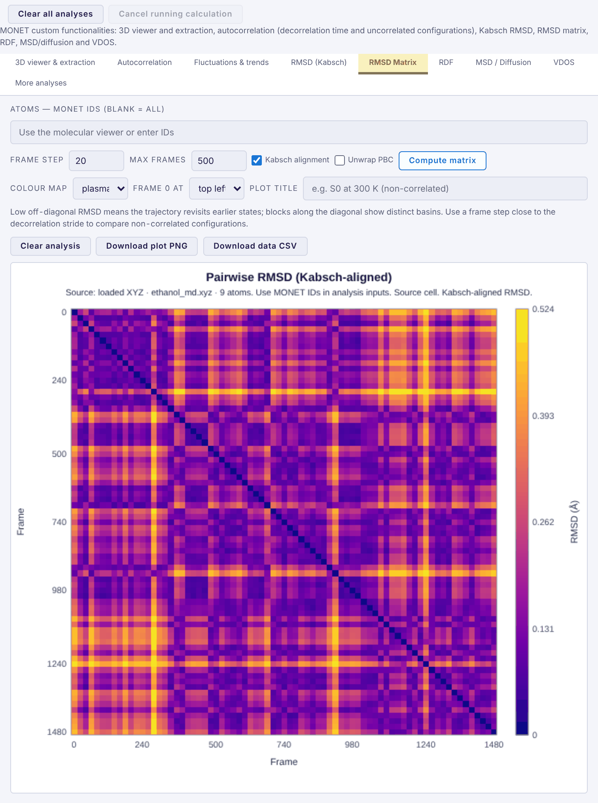

**Steps.**

1. Enter the atoms (blank = all), the **Frame step** (up to 3000 analysed frames), and the alignment options.
2. Press **Compute matrix**.
3. Choose the colour map, where frame 0 is (top-left or bottom-left) and a title under the plot.

**Watch out.** Use a frame step close to the decorrelation stride (section 6.3), or run it on the uncorrelated trajectory, to compare independent configurations. MDAnalysis has the same matrix (section 7.5).

### 6.7 RDF

**What it tells you.** The **radial distribution function** g(r): how likely it is to find an atom at distance r from another, compared with a uniform distribution at the same density. Peaks are coordination shells; g(r) → 1 far away in a liquid.

 of the O–O pair of the box of waters; the first peak is the first coordination shell. A periodic cell is required; Rmax is limited to half the smallest cell width.")

**Steps.**

1. Check that the cell is set (section 4.4): the RDF needs a periodic cell.
2. Enter an **element pair** (`O O`, `O H`; blank = all atoms) and optionally restrict it to some MONET IDs.
3. Set **Bins** and **Frame step**; leave **R max** empty for the largest allowed value.
4. Press **Compute RDF**. **Plot** switches between g(r) and the running coordination number n(r).

**Reading the result.** The position of the first peak is the typical neighbour distance; n(r) at the first minimum is the number of neighbours in the first shell.

### 6.8 MSD and diffusion

**What it tells you.** The **mean-square displacement** MSD(t) = ⟨|r(t) − r(0)|²⟩: how far atoms travel in a time t. In a liquid it becomes a straight line, whose slope gives the **diffusion coefficient** D = slope / 6.

 of the whole system, O and H, and the linear fit (gold dashed). D = slope / 6, given in cm²/s and Ų/fs.")

**Steps.**

1. Set the time axis (section 4.5).
2. Enter the atoms (blank = all) and the **Frame step**.
3. Keep **Remove the system centre-of-mass drift** ticked.
4. Press **Compute MSD**, then adjust the **fit window** (from, to; 10–50 % of the lag range by default) to the straight part.

**Reading the result.** D is given for the selection and per element. At short times the MSD curves upwards (ballistic motion); at long times it becomes noisy because few time origins remain: fit in between.

**Watch out.** Positions are unwrapped with the minimum image, so the frame step must be small enough that atoms move less than half a cell between analysed frames (MONET warns otherwise).

### 6.9 VDOS

**What it tells you.** The **vibrational density of states**: which frequencies the atoms vibrate at, from the Fourier transform of their velocities. It is comparable to an IR or Raman spectrum without intensities.

, normalised to unit area. The Nyquist limit and the resolution are shown.")

**Steps.**

1. Set the time axis (section 4.5). Velocities are computed from consecutive frames, so use frames saved every MD step, or every few steps.
2. Enter the atoms (blank = all), the **Frame step**, the **Smoothing** and the upper frequency **Up to**.
3. Tick **Mass-weighted** if you want each atom weighted by its mass, and press **Compute VDOS**.

**Reading the result.** The highest frequency that can be measured (Nyquist limit) is 1/(2 × the time between frames); the resolution is 1/(total time). Both are shown: frames saved too rarely cut off the high frequencies, a short run blurs the peaks.

## 7. The MDAnalysis module

### 7.1 Running an analysis

**What it is for.** The analysis modules of MDAnalysis on the same trajectory, cell, frame step and MONET IDs: RMSD and RMSF, PCA, hydrogen bonds, contacts, densities, protein and nucleic-acid analyses and more (section 7.5).

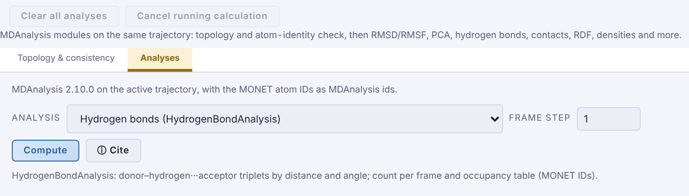

**Steps.**

1. Open the **MDAnalysis** module tab, then **Analyses**.
2. Choose the analysis in the **Analysis** menu; its description and fields appear.
3. Fill the fields. Selections use the MDAnalysis language: `all`, `element O`, `resname H2O`, `id 1 2 3` (MONET IDs), `around 3.5 resname LIG`. **← picked** inserts the atoms picked in the viewer.
4. Set the **Frame step** and press **Compute**. **ⓘ Cite** shows what to cite.

### 7.2 RMSD and RMSF

**What they tell you.** *rms.RMSD* is the RMSD after optimal superposition (as section 6.5, with MDAnalysis), with extra groups measured after the same fit. *rms.RMSF* is the **root-mean-square fluctuation** of each atom around its average position: which atoms move most.

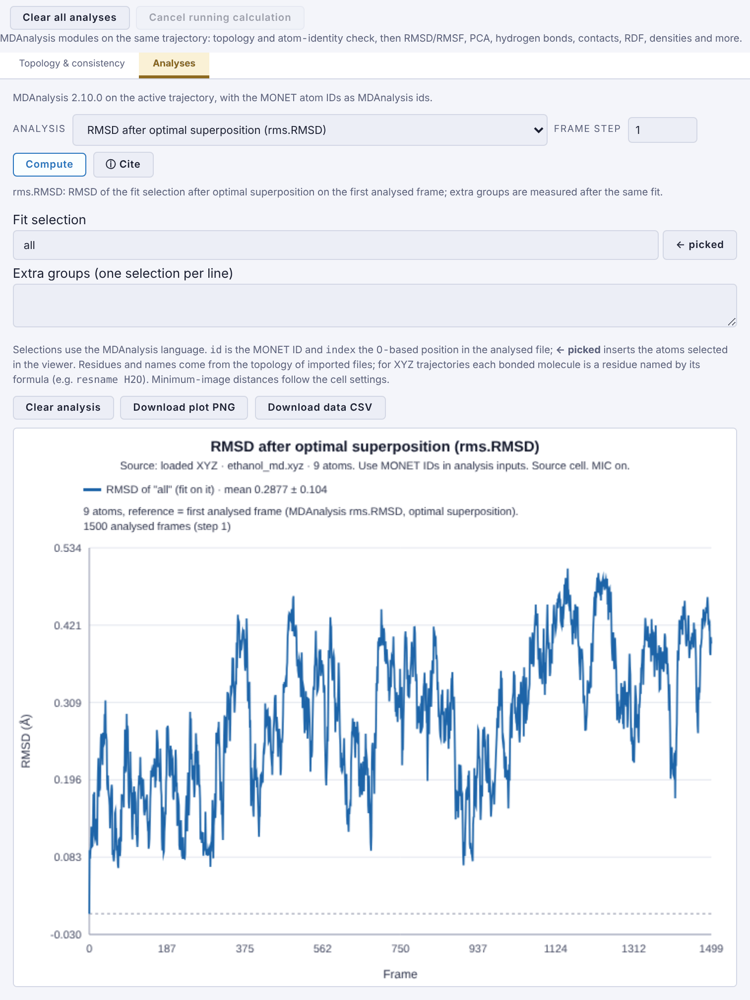

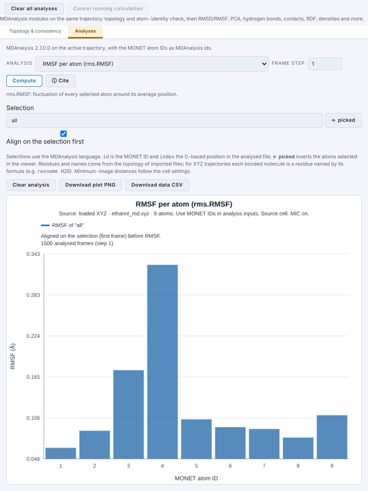

**Steps.**

1. Choose *RMSD after optimal superposition* or *RMSF*.
2. For RMSD enter the **Fit selection** (e.g. `all` or `not element H`) and optional **Extra groups** (one selection per line); for RMSF enter the **Selection** and keep **Align on the selection first** ticked.
3. Press **Compute**.

### 7.3 Principal component analysis (PCA)

**What it tells you.** PCA finds the **collective motions** that account for most of the fluctuation of the structure: component 1 is the largest one. Projecting each frame on the components shows where the trajectory goes; picking frames along a component gives configurations that span that motion.

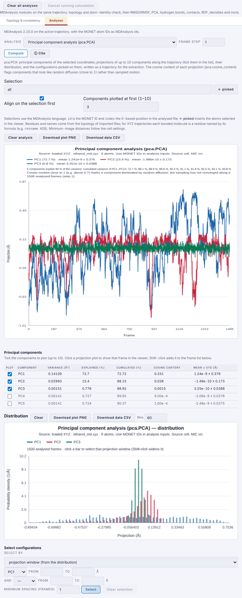

**Steps.**

1. Choose *Principal component analysis (pca.PCA)*, enter the **Selection** and keep **Align on the selection first** ticked.
2. Press **Compute**.
3. In the **Principal components** table tick the components to plot.
4. Under **Select configurations** choose how to pick them: a **projection window** (click a bar of the distribution, or type the range), the **extremes** of a component, or a **frame list**. Set **Minimum spacing (frames)** to the decorrelation stride (section 6.3), so the picks are independent, and press **Select**.
5. Press **Write the selected configurations**, then **Use them for the extraction** to make them the active trajectory.

**Reading the result.** *Explained* is the share of the total fluctuation of each component. A **cosine content** close to 1 means the component looks like random diffusion: the motion is not sampled enough to be meaningful.

### 7.4 Hydrogen bonds

**What it tells you.** Which donor–hydrogen···acceptor triplets form hydrogen bonds, how many there are in each frame, and for what fraction of the time each one exists (**occupancy**).

 and the occupancy table with MONET IDs.")

**Steps.**

1. Choose *Hydrogen bonds (HydrogenBondAnalysis)*.
2. Enter the **Donors**, **Hydrogens** and **Acceptors** selections (defaults: `element O N F` and `element H`).
3. Set the **D–A cutoff** (3 Å) and the **D–H–A minimum angle** (150°), then press **Compute**.

**Reading the result.** The plot is the number of hydrogen bonds per frame; the table lists each bond with its MONET IDs and occupancy. For how long a bond survives use *Hydrogen-bond lifetime* or *Hydrogen-bond autocorrelation* in the same menu.

### 7.5 What is available

| Group | Analyses |
|---|---|
| Structure and dynamics | RMSD, pairwise RMSD matrix, RMSF, radius of gyration, PCA (with cosine content), EinsteinMSD, GNM, diffusion map, aligned trajectory, average structure, bond–angle–torsion coordinates |
| Interactions and distances | hydrogen bonds, their lifetime and autocorrelation, water bridges, contacts, contact map, InterRDF and site-specific RDF, centre-of-mass and minimum distances, atomic distances, dihedrals |
| Densities | linear density, density grid (OpenDX) |
| Membranes, polymers, dielectrics | leaflets, persistence length, dielectric constant (needs charges) |
| Proteins | Ramachandran, DSSP, Janin χ1/χ2, helix geometry |
| Nucleic acids | base-pair distances, backbone torsions and sugar pucker |

Not included: `encore`, `psa`, `waterdynamics` (deprecated), `hole2` and `legacy.x3dna` (external programs). The analyses that write a trajectory (aligned trajectory, average structure, PCA selection) offer a button to make it the active trajectory.

## 8. A complete study, step by step

This is the order recommended in `docs/md-analysis-workflow.md`, which gives the literature behind each step. Each step names the section that explains it.

1. **Open** the trajectory, with its cell or topology if needed (section 3.1, 3.2).
2. **Check the atoms** in *MDAnalysis › Topology & consistency* (section 3.3) and **analyse the structure** of the first frame (section 5.1): intact molecules, sensible distances, the right cell.
3. **Set the cell and the time axis** (sections 4.4, 4.5). Without them the periodic distances, MSD, VDOS and the autocorrelation are wrong or disabled.
4. **Look** at the trajectory with the player (section 4.6): nothing exploding, molecules not broken.
5. **Is it equilibrated?** *Detect equilibration* on a slow quantity (section 6.1); if a transient is found, use the production window. The energy stored in the file (*ASE › More analyses › Values stored in the file*) is another check.
6. **How correlated is it?** Compute the autocorrelation of the same slow quantity on the production window (section 6.2). Check that the run lasts at least 20–50 τ and that block averaging reaches a plateau.
7. **Analyse the full-resolution run**: geometry and distributions (sections 5.2–5.4), fluctuations (6.4), RDF, MSD, VDOS (6.7–6.9), MDAnalysis (7). Quote the SEM, not the SD, as the uncertainty of a mean (section 2.5).
8. **Build the uncorrelated trajectory** with *Accept t\** (section 6.3): it becomes the active trajectory.
9. **Extract** the configurations and write the QM inputs (section 9). Because the uncorrelated trajectory is active, the sampling frequency is already 1.
10. **Keep the record**: *History › Save session* (section 10.2) and *ⓘ References* (section 10.3).

## 9. Extraction and quantum-chemistry inputs

The extraction writes, for the atoms you choose, the full trajectory of those atoms, the sampled configurations and one set of QM inputs per configuration. It runs on the active trajectory (section 2.4).

### 9.1 Open the extraction

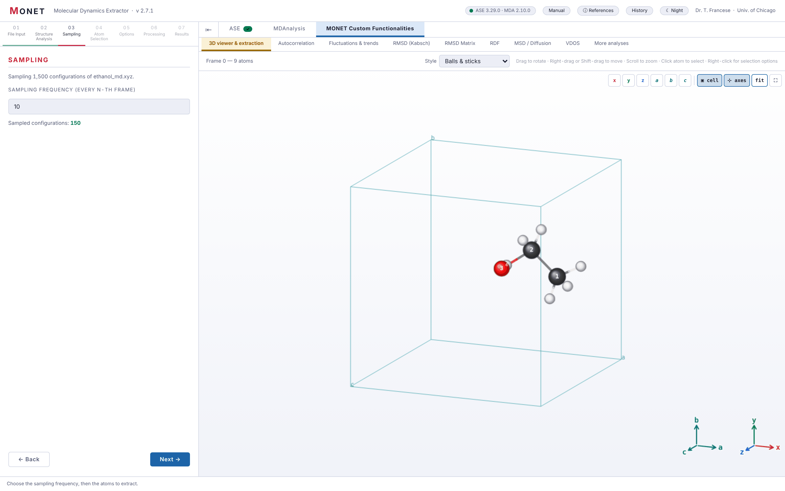

**Steps.** Press **Extraction →** (in the rail at the left, in the ASE header, or in step 02). The workflow panel opens at step 03 and the viewer switches to **3D viewer & extraction**, where you pick the atoms to extract.

### 9.2 Step 03 — Sampling

**What it is for.** Choosing which configurations to extract: one every N-th frame of the active trajectory.

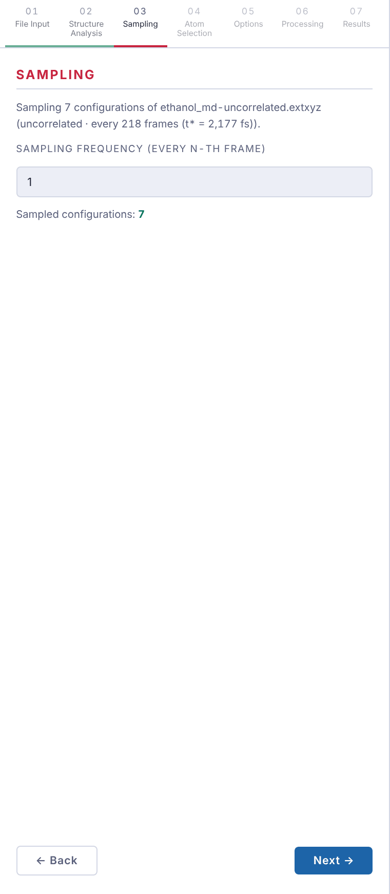

**Steps.**

1. Read the first line: which trajectory is sampled and how many configurations it has.
2. Set the **Sampling frequency**:
  - if you accepted t* (section 6.3) the uncorrelated trajectory is active and the frequency is already **1**: every frame is independent;
  - if you used *Only set the sampling frequency*, it already holds the stride;
  - otherwise type the stride yourself.
3. Check **Sampled configurations** and press **Next →**.

### 9.3 Step 04 — Atom selection

**What it is for.** Choosing the atoms to keep in the extracted configurations, for example the molecule you will compute with QM and its first solvation shell.

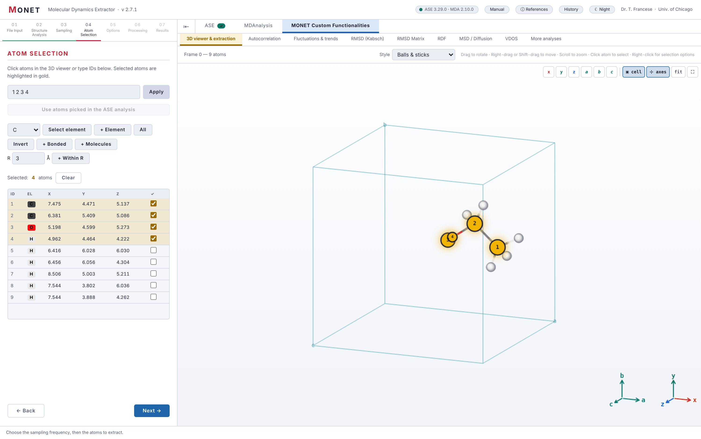

**Steps.**

1. Click the atoms in the 3D viewer, or type MONET IDs (`1 5 12 23`) and press **Apply**, or press **Use atoms picked in the ASE analysis** to reuse the picks of section 4.2.
2. Extend the selection with the toolbar (*element, All, Invert, + Bonded, + Molecules, + Within R*) or the right-click menu (section 4.3).
3. Check the count under **Selected** and press **Next →**.

### 9.4 Step 05 — Options and quantum-chemistry codes

**What it is for.** Choosing what the extraction writes besides the coordinates: the average structure and the inputs of one or more QM codes.

 are shared by all the codes.")

**Steps.**

1. Tick **Compute average structure** to get `GEO-AVERAGE.xyz` (all atoms, simple Cartesian average over all frames).
2. Tick the codes you need: **Gaussian, ORCA, QE pw.x, VASP, CP2K, Qbox**.
3. Set the **Charge** and the **Multiplicities** (one file per multiplicity: 1 → `sing`, 2 → `doub`, 3 → `trip` …).
4. Open each code's card and set its options (below); press **Preview (configuration 1)** to see the file it will write.
5. Read the status line under the cards, then press **Run →**.

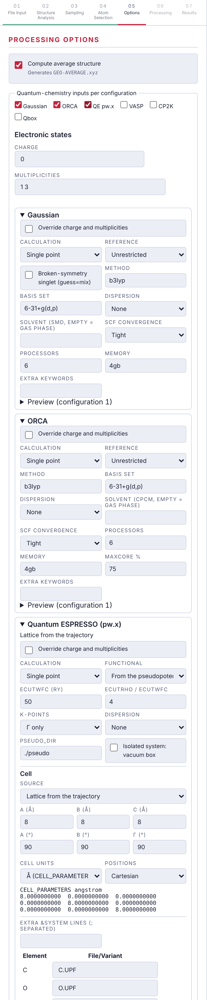

* Each card sets the calculation type (single point, optimisation, frequencies, TD-DFT, MD …), method or functional, basis set or cutoff, dispersion, solvent, k-points, pseudopotentials and extra keywords, and can override the charge and multiplicities.
* **Edit templates** replaces a generated file with your own text (with placeholders such as `{coords}`, `{charge}`, `{mult}`); the card then shows *custom template*.
* Gaussian and ORCA need no cell. The plane-wave codes (QE, VASP, CP2K, Qbox) need one, taken in this order: the card's *Isolated system: vacuum box* flag, the card's custom cell, the cell of section 4.4, the cell of each frame. Without a cell **Run** stays disabled and **Define cell…** takes you to the cell panel.
* VASP **Build POTCAR** reads your own POTCAR library (launcher only); MONET never ships POTCAR files.

### 9.5 Steps 06 and 07 — Processing and results

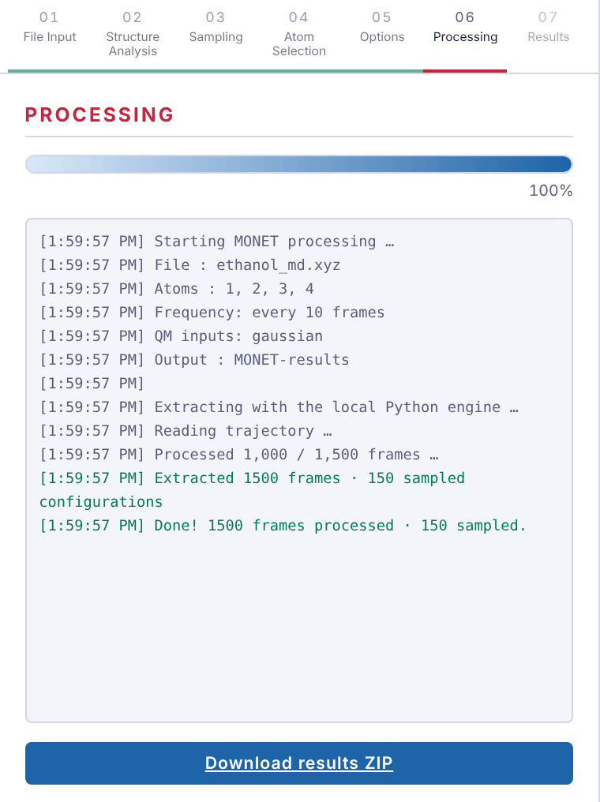

**Steps.**

1. Step 06 shows the progress and a log; **Cancel extraction** stops it.
2. When it is done, press **Download results ZIP** (in the desktop app the files go to the folder you chose).
3. **Results →** shows the summary and the folder tree.

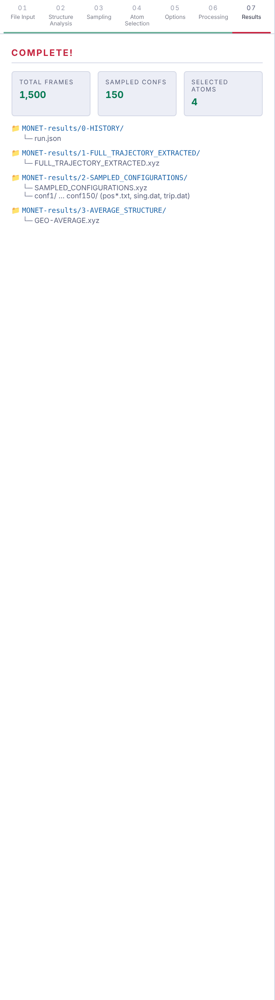

**Reading the result.** The ZIP contains:

* `0-HISTORY/run.json` — the settings of the extraction;
* `1-FULL_TRAJECTORY_EXTRACTED/` — the selected atoms in every frame;
* `2-SAMPLED_CONFIGURATIONS/` — `SAMPLED_CONFIGURATIONS.xyz`, and for each configuration `confN/posN.txt` with its QM inputs (Gaussian in `confN/`, the others in `confN/orca/`, `confN/qe/`, `confN/vasp/`, `confN/cp2k/`, `confN/qbox/`);
* `3-AVERAGE_STRUCTURE/GEO-AVERAGE.xyz` — the average structure, if requested.

**ASE Analysis →** goes back to the analyses, now on the extracted trajectory; **New Run** starts another extraction.

## 10. History, console and reports

### 10.1 The history and the console

**What it is for.** MONET logs every step that changes a result: the file and its checksum (SHA-256), the cell and the time axis, each analysis with its parameters and key numbers, derived trajectories and exports. Rotating the view or changing colours is not logged. The log stays on your computer (`~/.monet/sessions/`, saved automatically) and stores file names, never paths. It lets you report exactly what you did and repeat it.

: every step is a call, e.g. acf(quantity=dihedral, groups=[[1, 2, 3, 4]], …). Click a line, edit it and press Enter to run it again; help() lists the analyses.")

**Steps to repeat a step with other parameters.**

1. Press **History** in the title bar (or Ctrl+`) and open the **Console** tab.
2. Click a line: it is copied into the input field at the bottom.
3. Change a parameter (e.g. `frame_step=5`) and press Enter. The analysis runs again through its panel, with the same checks as its button; the new step is linked to the original.
4. Type `help()` for the list of analyses, `help(acf)` for the parameters of one.

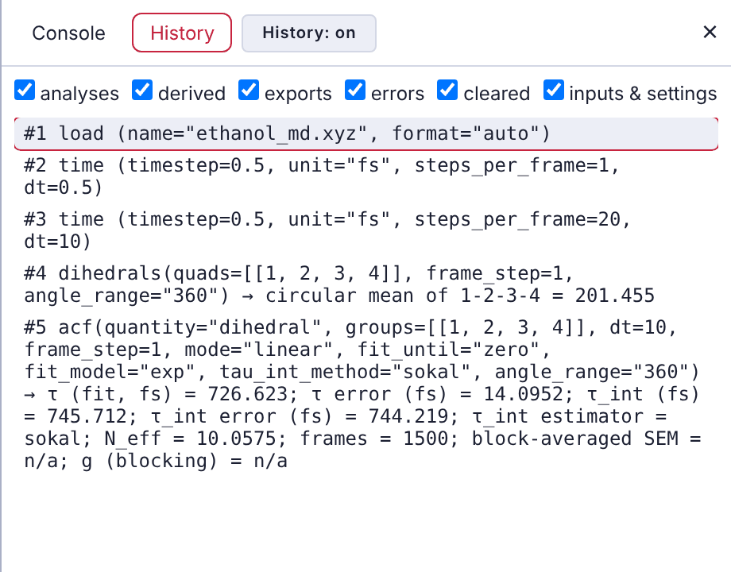

**Steps to annotate the log.** In the **History** tab click a step to see its details and parents; write a **Note**, tick **☆ final** for the results you will publish. **History: on / paused** stops logging for a while (the report then mentions the gap).

### 10.2 Save, reopen and replay

**Steps.**

1. **Save session** writes a ZIP with `session.json`, `methods.md` (and `methods.docx` if pandoc is installed) and `replay.py`. `methods.md` lists the software versions with citations, the checksums of the inputs, every step and a pre-filled reporting checklist. **Export methods report** and **Export replay.py** write those two files alone; with *final steps only* ticked the report keeps only the ☆ steps.
2. **Open session** restores a saved log read-only (it never re-runs anything). Load the trajectory with the same checksum to continue working on it; the reopened log is a copy and never overwrites the original.
3. To repeat the whole analysis without the window, run `python replay.py --monet /path/to/MONET` in the folder that holds the trajectory. It checks the checksums, re-runs every step and compares the key numbers with the logged ones: `OK`, `DIFF`, or `RAN` when there is nothing raw to compare.

### 10.3 What to cite

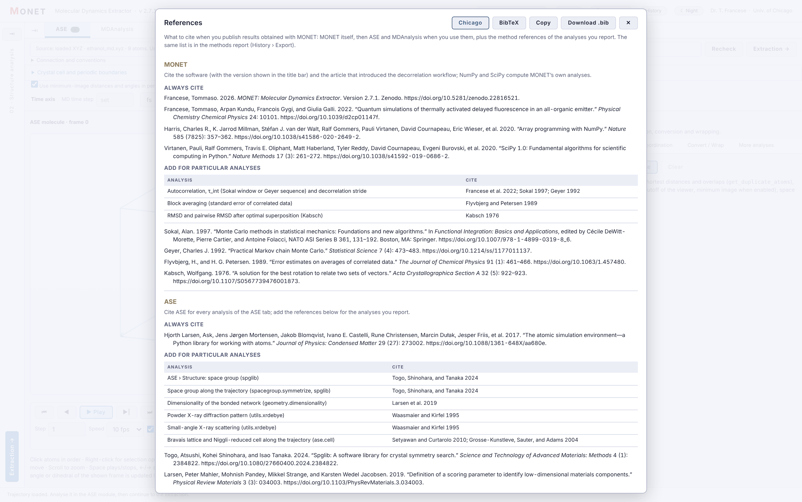

**Steps.** Press **ⓘ References** in the title bar (or **ⓘ Cite** next to an analysis for that one only), choose **Chicago** or **BibTeX**, then **Copy** or **Download .bib**.

## 11. Adding your own analyses (plugins)

**What it is for.** An analysis of your own, written as one Python function, with the same form, plot, history and replay as the built-in ones.

A plugin is a function decorated with `@analysis`: it declares its fields (`params`), receives the frames of the active trajectory (`ctx.frames()`) and returns a series to plot. This one measures the distance between pairs of atoms:

```python
import numpy as np
from monet_registry import Param, analysis, series

@analysis('end_to_end', engine='custom', label='End-to-end distance',
          description='Distance between the first and the last atom of each pair, in every analysed frame.',
          params=[Param.groups('pairs', 'Pairs of MONET IDs', width=2)])
def end_to_end(ctx, p):
    data = ctx.frames()
    values = {}
    for a, b in p['pairs']:
        values[f'{a + 1}–{b + 1}'] = np.linalg.norm(data.positions[:, b] - data.positions[:, a], axis=1)
    return series(data.frames, values, y_label='Distance (Å)')
```

**Steps.**

1. Save the code above as `~/.monet/plugins/end_to_end.py` (create the folder if needed).
2. Stop the launcher (Ctrl+C) and start it again: plugins are read at start-up.
3. Open the *More analyses* tab of the module (`engine='custom'` → MONET Custom Functionalities, `'ase'` → ASE, `'mdanalysis'` → the MDAnalysis menu), choose your analysis, fill the fields and press **Compute**.

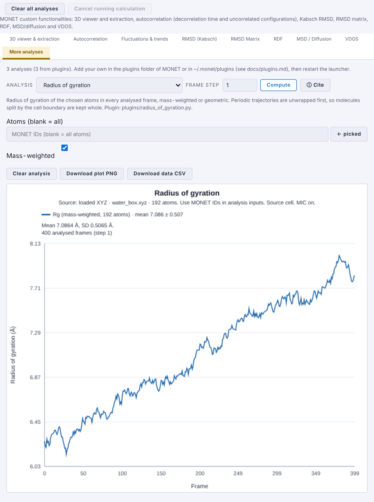

Plugins are read from `plugins/`, `~/.monet/plugins/`, the folders of `MONET_PLUGINS` and installed packages. They run with your user rights: use only code you trust. A plugin that fails to load is listed with its error; the others keep working. The full reference is `docs/plugins.md`.

## 12. Working with an AI assistant (MCP)

**What it is for.** `monet_mcp.py` lets an AI assistant that speaks the Model Context Protocol (Claude Desktop, Claude Code, Gemini CLI) run MONET for you: you ask in plain language to open a trajectory, run an analysis or write a derived trajectory, without the MONET window.

**Steps.**

1. Install the SDK in MONET's environment: `.venv/bin/python -m pip install "mcp>=1.2"` (Windows: `.venv\Scripts\python -m pip install "mcp>=1.2"`).
2. Register the server in your assistant, with the absolute path of that Python, the folders it may read (`--data`) and the folder it writes to (`--output`); `docs/mcp.md` gives the exact command or configuration for each assistant.
3. Ask, for example: *open ~/runs/ethanol.xyz with a 0.5 fs time step and tell me whether it is equilibrated*.

The server runs on your computer and never reads outside `--data` or writes outside `--output`; the results it returns go to your assistant's provider like any chat content.

## 13. Troubleshooting

| Problem | What to do |
|---|---|
| The ASE badge in the title bar does not show the ASE version | Use the launcher (not `index.html`); press **Recheck**; if the connection is lost, stop the launcher and start it again. |
| *Cannot start MONET* / port busy | Start with `--port 8766` (or another free port). |
| macOS or Windows blocks the launcher | macOS: right-click › **Open**; Windows: **More info › Run anyway**. |
| MSD, VDOS or the autocorrelation are disabled | Enter the MD time step in the **Time axis** row (section 4.5). |
| Periodic distances look wrong | Define the cell (section 4.4) and tick the minimum-image box; the periodic directions must be on. |
| *Atom identity* shows red cells | MONET, ASE and MDAnalysis read different atoms (wrong reference structure or atom order): load the right topology (section 3.3). |
| An XTC/TRR/DCD trajectory has every atom as X | Add the topology as the reference structure (section 3.2). |
| A result disappears after changing the cell | Applying a cell or changing the minimum-image box clears the analyses on purpose; compute again. |
| The analyses run on fewer frames than expected | A derived trajectory is active (section 2.4): read the Source line, press **↩ Full trajectory** to go back. |
| An analysis stays at 0 % | Press **Cancel running calculation**; very long ACF lags can be limited with **Max lag**. |
| An ASE or MDAnalysis analysis is not offered | The module is missing from the Python environment of the launcher: reinstall `requirements.txt`. |

## 14. Keys and mouse

| Action | How |
|---|---|
| Rotate / move / zoom the viewer | drag / right-drag or Shift-drag / wheel |
| Pick or release an atom | click (or the row of the atom table) |
| Selection menu | right-click an atom or empty space |
| Play or stop, step | Space, ← / → |
| Leave the expanded viewer | Esc |
| Open the history and console | Ctrl+` |
| Zoom a plot / reset | drag across it / double-click |

## 15. Citing, licence and redrawing the pictures

Cite MONET (T. Francese, *MONET: Molecular Dynamics Extractor*, Zenodo, doi:10.5281/zenodo.22816521, with the version shown in the title bar) together with the PCCP 2022 article (doi:10.1039/d2cp01147f) and the libraries of the analyses you used; **ⓘ References** writes the list (section 10.3). MONET is under the MIT licence; ASE and MDAnalysis are separate packages under their own licences.

The pictures of this manual are drawn from the running program by `tools/make_manual_images.py` (it needs `pip install playwright pillow` and Chromium). After a change of the interface run `python tools/make_manual_images.py` (or `--only window,acf_result`) and commit the new `manual/img/*.png`; the workflow diagram `manual/img/workflow.svg` is drawn by hand. The text is `manual/MANUAL.md` and `manual/MANUAL.it.md`; keep the same sections and pictures in both: a test checks it.

### Revision history

| Version | Date | Change |
|---|---|---|
| MONET 2.7.1 | 2026-10-10 | First version of the manual (English and Italian). |
| MONET 2.7.1 | 2026-10-10 | Key concepts (MONET ID, time axis, minimum image, active trajectory, SD and SEM) and a workflow diagram; every analysis explained with what it tells you, steps, how to read the result and what to watch out for; new pictures of Use selection, the active trajectory and the plateau validation. |
